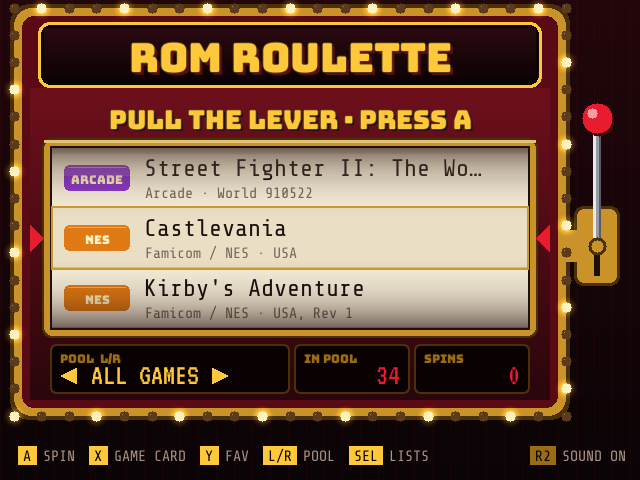
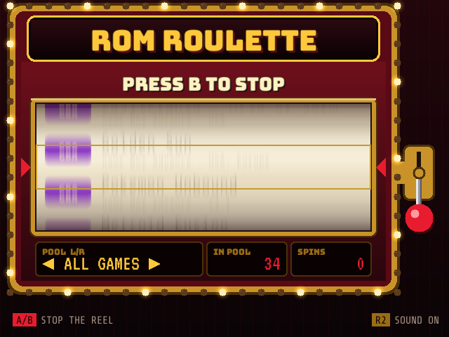
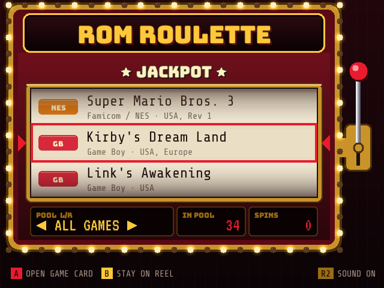
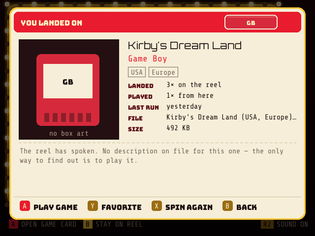
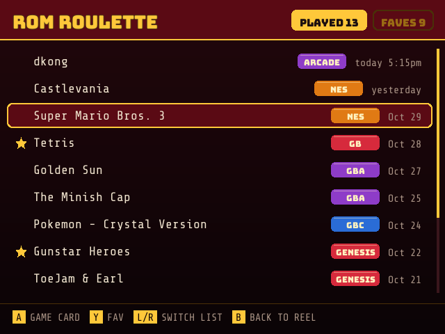
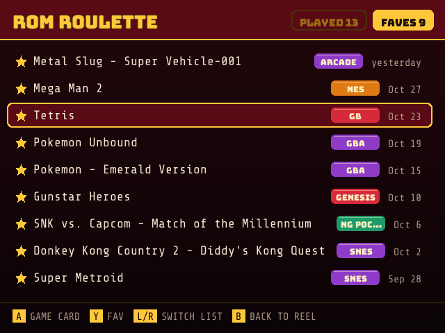

# ROM ROULETTE

**A slot machine for your ROM collection, for OnionOS on the Miyoo Mini Plus.** Pull the lever, stop the reel and play whatever it lands on. Too many games and can't pick one? Let the reel decide.

> 🤖 **Built by Claude.** ROM Roulette was designed and written by [Claude](https://claude.ai), Anthropic's AI model, at the request of [@snyderman3000](https://github.com/snyderman3000). He came up with the idea, chose the direction and tested it on real hardware. Claude wrote the code, the sound effects, the documentation and the artwork. Please report bugs through [Issues](https://github.com/snyderman3000/ROM-Roulette/issues).

| | |
|---|---|
|  |  |
|  |  |
|  |  |

🔊 [Hear a spin](docs/sound-preview.wav) (13 seconds: boot jingle, lever, reel, jackpot, favorite, launch).

## Features

- **Every game on your card.** ROM Roulette reads each installed emulator's `Emu/<system>/config.json` the same way OnionOS's game list does, so it sees the same folders and file types. Multi-disc `.m3u` sets and `.cue`/`.bin` pairs count once, and macOS `._` files are ignored.
- **A fair spin.** The winner is drawn evenly from the pool the moment you stop the reel, and placed on a row that hasn't scrolled into view yet, so it doesn't matter when you press stop.
- **A game card before you play.** After the jackpot, a card shows the title, system, region tags, file size and how often the game has come up and been played. Box art comes from each system's `Imgs` folder (the same art OnionOS shows). If you've scraped your games and have a `gamelist.xml`, the card also shows the description, genre, year and developer.
- **Pools.** Spin across all games, only your favorites, games you've never played from ROM Roulette, or a single system.
- **Played list and favorites.** Every game you launch from ROM Roulette is listed with when you played it. Favorites can be added from the reel, the game card or the lists.
- **Launches like OnionOS does.** Games start through Onion itself, the same way its built-in Random Game app does, so they show up in Recents, the GameSwitcher and Play Activity. Quitting the game takes you back to Onion's main menu.
- **8-bit arcade sound.** A coin and lever pull, reel clicks that slow down as it stops, a brake and clunk, a jackpot fanfare, menu blips and a power-up as the game starts. All of them are original chip-style sounds (square, triangle and noise channels) made for ROM Roulette. R2 turns them off.
- **Vegas cabinet look.** Chasing marquee bulbs, a pull lever, a motion-blurred reel and LCD counters.

## Install

1. Download `ROMRoulette-vX.Y.Z-OnionOS.zip` from [Releases](https://github.com/snyderman3000/ROM-Roulette/releases), or install it from [Mixtape](https://github.com/snyderman3000/mixtape).
2. Extract it and copy the `App` folder to the root of your SD card, merging it with the `App` folder already there.
3. Open **Apps → ROM Roulette**.

Made for OnionOS on the Miyoo Mini Plus. It should also work on the original Mini; that hasn't been tested.

## Controls

The bottom bar always shows what the buttons do at that moment.

| Where | Button | Action |
|---|---|---|
| Reel | A or START | Spin |
| | X | Game card for the game on the payline |
| | Y | Add or remove favorite |
| | L / R | Change pool |
| | Up / Down | Nudge the reel by hand |
| | SELECT | Played list and favorites |
| | B or MENU | Quit |
| Spinning | A, B or START | Stop the reel |
| Jackpot | — | The game card opens by itself after a second |
| | A | Open the game card now |
| | B | Stay on the reel |
| Game card | A or START | Play the game |
| | Y | Add or remove favorite |
| | X | Spin again |
| | B | Back |
| Lists | A | Game card |
| | Y | Add or remove favorite |
| | L / R | Switch between Played and Favorites |
| | B | Back to the reel |
| Anywhere | R2 | Sound on or off |

## Files

Everything ROM Roulette keeps is in `App/ROMRoulette/data/`:

- `state.json`: your played list, favorites, spin count and per-game counts.
- `romroulette.log` and `sound.log`: what happened during the last session. If something goes wrong, these are the files to attach to an issue.

## How sound works

OnionOS plays app and game audio through its audioserver, reached by preloading `miyoo/lib/libpadsp.so` into each program. ROM Roulette's main program is a static Go binary, which a preloaded library can't hook. So it starts a small helper, `rrsfx` (a few hundred lines of C in [`sfx/rrsfx.c`](sfx/rrsfx.c)), with that library preloaded, and sends it one-line commands over a pipe. The helper mixes the effects and exits before a game starts, so the game gets the audio device.

One thing worth knowing if you write a helper like this: Onion's `libpadsp.so` only looks up the system's real `open()` the first time a program opens an ordinary file. If `/dev/dsp` is the first file a program opens, it calls a null pointer and crashes. `rrsfx` opens `/dev/null` first. Building with `_FILE_OFFSET_BITS=64` also breaks it, because `open()` becomes `open64()`, which the library doesn't hook. If you have MiniAmp's "music in games" turned on, ROM Roulette uses Onion's original library (`libpadsp_orig.so`) rather than MiniAmp's wrapper.

## Building

You need Go 1.24 and the [Miyoo Mini toolchain](https://github.com/shauninman/miyoomini-toolchain-buildroot/releases) (for the sound helper):

```sh
TOOLCHAIN=/path/to/miyoomini-toolchain ./build.sh
```

This runs the tests, cross-compiles the app for ARMv7, generates the sound effects (`tools/sfxgen`), builds `rrsfx` and writes `dist/ROMRoulette-vX.Y.Z-OnionOS.zip`.

To see screens on a computer without the device, render them to PNG against a folder laid out like an SD card:

```sh
go build -o rr . && RR_SDROOT=/path/to/sdcard RR_DATA=/tmp/rr ./rr -shot card -out card.png
```

Scenes: `loading`, `idle`, `spin`, `stopping`, `landed`, `card`, `played`, `faves`, `empty`.

Releases are published by GitHub Actions: bump `version` in `main.go`, add `docs/releases/vX.Y.Z.md` and push to `main`.

## License

MIT (see [LICENSE](LICENSE)). The bundled fonts and libraries keep their own licenses; see [THIRD_PARTY_NOTICES.md](THIRD_PARTY_NOTICES.md).
